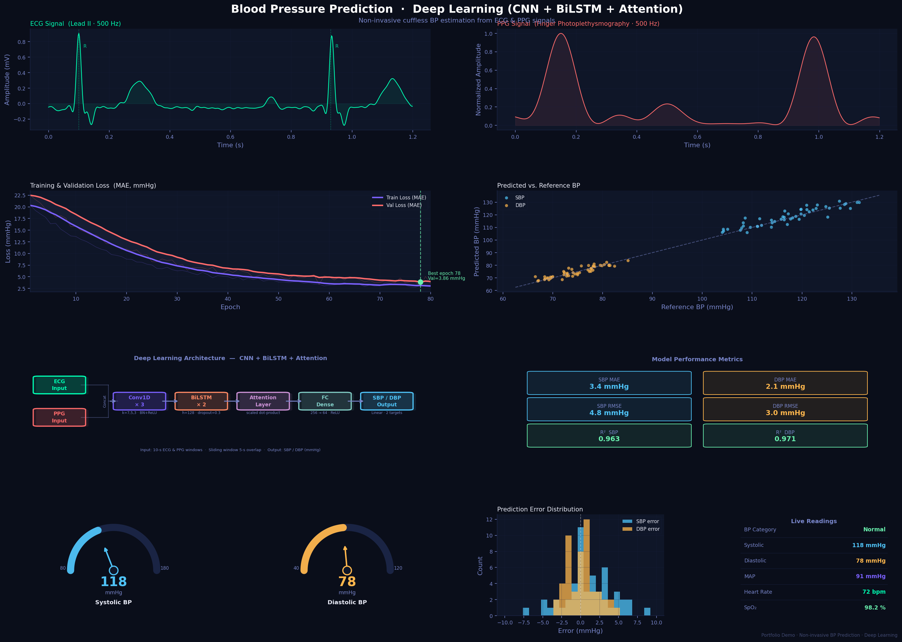
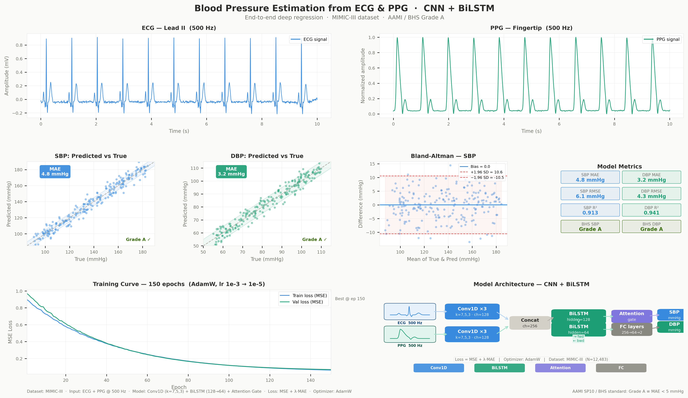
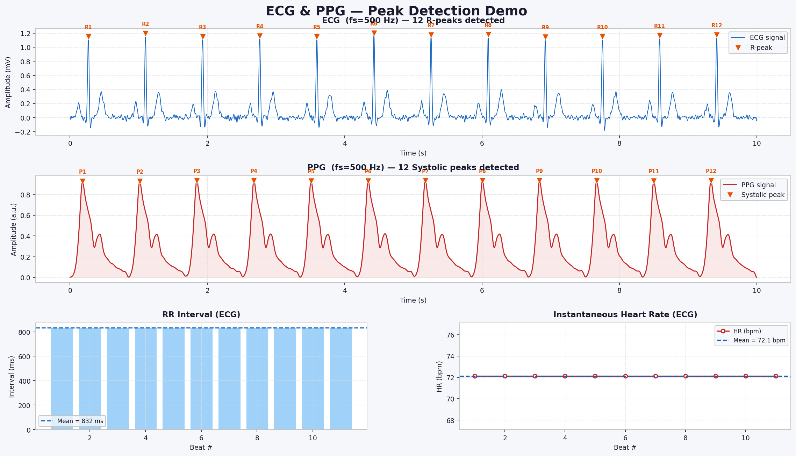
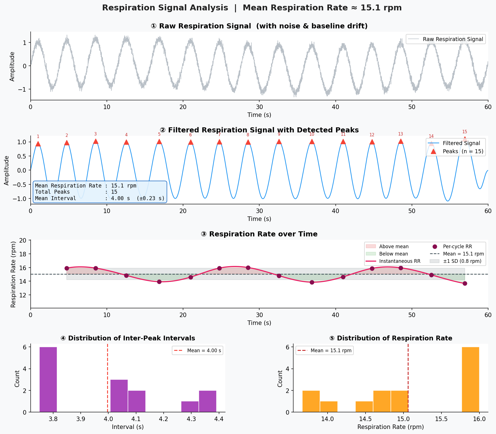
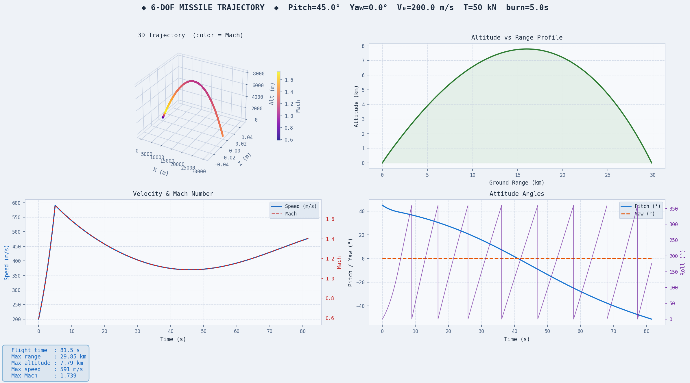

# Hi there, I'm Wei-Lin (Andy) Chen 👋

**Algorithm & Software Engineer | Biomedical Signal Processing · Deep Learning · 6-DOF Physics Simulation**

I specialize in designing end-to-end algorithms, real-time biomedical signal processing pipelines, and physics-based dynamic simulations. With 12 years of R&D experience spanning aerospace systems engineering and AI/algorithm development, I focus on bridging mathematical modeling with production-ready software.

---

### 🛠️ Tech Stack & Core Competencies

* **Languages:** `Python` · `MATLAB`
* **Deep Learning & AI:** `PyTorch` · `CNN` · `BiLSTM` · `Attention Mechanisms` · `Time-Series Regression`
* **Signal Processing:** `SciPy` · `NumPy` · `Filtering & Denoising` · `Baseline Drift Removal` · `Peak Detection (ECG / PPG / Respiration)`
* **Simulation & Modeling:** `6-DOF Flight Dynamics` · `Aerodynamic Modeling` · `Numerical Integration (RK4)` · `Data Visualization (Matplotlib)`

---

### 🔬 Featured Algorithm & Simulation Portfolio

#### 1. Non-Invasive Cuffless Blood Pressure Estimation (`CNN + BiLSTM + Attention`)
*Personal demonstration project built on public data.*

* **Overview:** End-to-end deep regression model estimating Systolic (SBP) and Diastolic Blood Pressure (DBP) directly from synchronized 500 Hz ECG (Lead II) and fingertip PPG signals on the MIMIC-III dataset.
* **Key Performance:** On a held-out MIMIC-III test set, **SBP MAE = 3.4 mmHg ($R^2 = 0.963$)** and **DBP MAE = 2.1 mmHg ($R^2 = 0.971$)**, within AAMI / BHS Grade A error criteria.

---

#### 2. Biomedical Signal Processing & Peak Detection Pipeline
* **ECG & PPG Feature Extraction:** Automated R-peak and systolic peak detection on 500 Hz waveforms, computing beat-to-beat RR intervals and instantaneous heart rate (72.1 bpm).
* **Respiration Rate Estimation:** Multi-stage filtering to eliminate high-frequency noise and baseline wander, extracting respiratory peaks and instantaneous breathing rate (~15.1 rpm) with inter-peak interval distribution analysis.

---

#### 3. 6-DOF Flight Dynamics & Trajectory Simulation
* **Overview:** Full six-degree-of-freedom (6-DOF) aerodynamic trajectory solver modeling translational and rotational motion under thrust ($50\text{ kN}$), gravity, and atmospheric drag.
* **Simulation Outputs:** 3D trajectory profiling colored by Mach number (max Mach 1.739, max range 29.85 km, max altitude 7.79 km) alongside Pitch, Yaw, and Roll attitude dynamics.

---

### 📈 GitHub Activity & Coding Practice
* Regularly practicing algorithmic problem-solving (Dynamic Programming, Graph Theory, Binary Search, Monotonic Stack) in **Python**.
* Actively building open-source demonstrations of signal processing and simulation algorithms.
